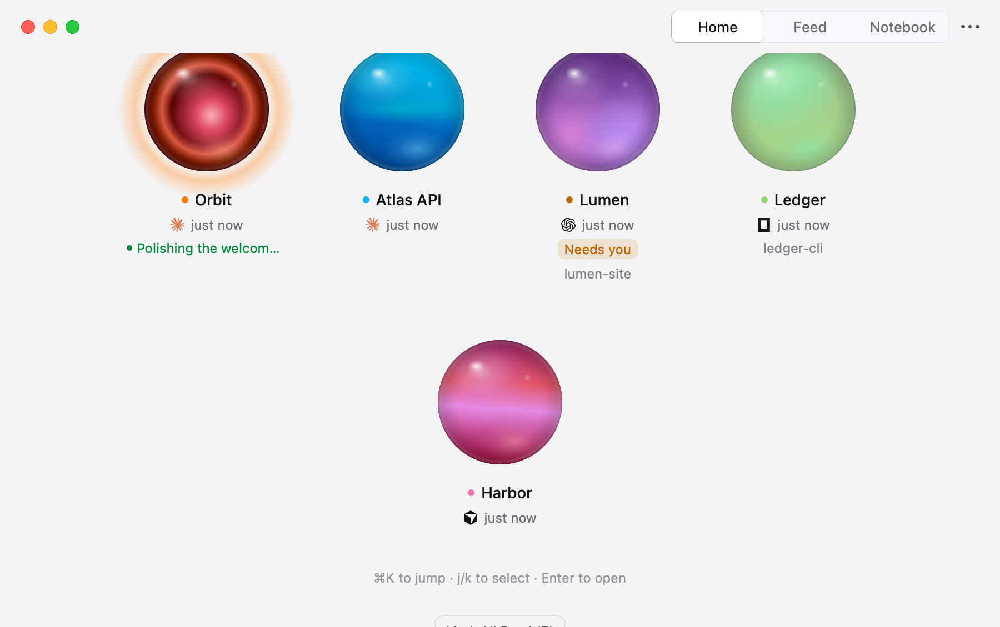

<p align="center"></p>

<h1 align="center">Feeder</h1>

<p align="center">A Mac app where your coding agents leave short updates on what they did, why, and what's next.</p>

<p align="center"><a href="https://github.com/mattjmdesign/feeder/releases/latest/download/Feeder.dmg"><strong>Download for Mac</strong></a> · Apple Silicon · macOS 13 or later · Free and open source</p>



Each project gets an orb on the Home screen and its own feed of updates. Agents post through a
local MCP server or the `feeder` command. It's built in Rust on [Rune](https://github.com/anomalyco/rune),
so it opens instantly and stays small. Everything stays on your Mac.

## Install

1. Download [Feeder.dmg](https://github.com/mattjmdesign/feeder/releases/latest/download/Feeder.dmg),
   open it and drag Feeder into Applications.
2. Open Feeder.
3. Go to **Settings → Agents**, press **Connect** next to each tool you use, then restart those tools.

Supported tools: Claude Code, Claude Desktop, Codex, Cursor, Antigravity, T3 Code and OpenCode.
For any other tool, **Copy config** gives you a snippet to paste into its MCP settings.

## Use it

In any project, ask your agent to *"post a Feeder update"*. Each update has three short parts:

- **Done**: what changed.
- **Why**: the reason for the change.
- **Next**: what to do next. If an agent starts this part with `Decision needed:` or `Blocked:`,
  the project shows **Needs you** until you reply.

An update can include one screenshot or short clip.

In the app:

- **Home** (⌘1) shows every project. A ring means an agent is working on it right now.
- **Feed** (⌘2) shows updates from every project in one list. ⌘F searches them.
- **Notebook** (⌘3) holds lessons agents write down, such as a bug fix that would help in another
  project. Agents search it before they start debugging.
- **⌘K** jumps to any project, update or notebook page.

You can also post from Terminal:

```sh
feeder post "Done: added sign-in.

Why: people couldn't save their work.

Next: add password reset."
feeder feed            # the latest updates for this folder's project
```

`feeder --help` lists every command.

## Privacy

Your projects, updates and screenshots are saved in `~/Library/Application Support/feeder` on your
Mac. Feeder has no account and collects no data. The only thing it sends over the internet is an
hourly check for a new version.

## Uninstall

1. In Feeder, open **Settings → Uninstall** and choose **Remove Feeder from all tools**.
2. Quit Feeder and move it to the Trash.
3. To delete your updates too, delete `~/Library/Application Support/feeder`.

## Contributing

See [AGENTS.md](AGENTS.md) for how to build, test and run Feeder from source.

## License

MIT. See [LICENSE](LICENSE). Claude, Codex, Cursor, Antigravity, T3 Code and OpenCode are trademarks
of their owners; Feeder isn't affiliated with them.
