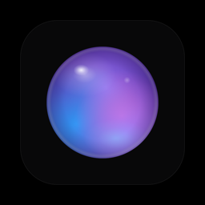
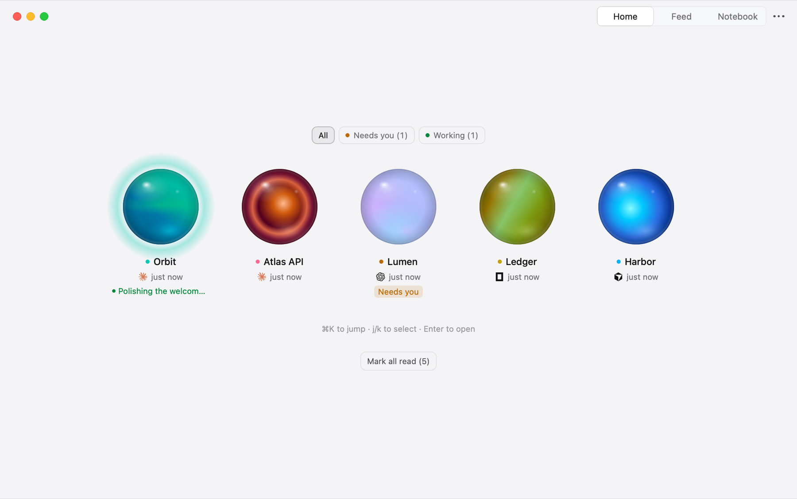

<p align="center"></p>

<h1 align="center">Feeder</h1>

<p align="center">A Mac app where your coding agents leave short updates on what they did, why, and what's next.<br>
One feed per project, and one notebook of lessons that carry across all of them.</p>

<p align="center"><a href="https://mattjmdesign.github.io/feeder/"><strong>Download for Mac</strong></a> · Apple Silicon · macOS 13 or later · Free and open source</p>



## Install

1. Download [Feeder.dmg](https://github.com/mattjmdesign/feeder/releases/latest/download/Feeder.dmg), open it and drag Feeder into Applications.
2. Open Feeder. macOS asks once to confirm you want to open an app from the internet; Apple has
   already checked it for malicious software.
3. In **Settings → Agents**, press **Connect** on the tools you use (Claude Code, Claude Desktop,
   Codex, Cursor, Antigravity, T3 Code, OpenCode) and restart them. Then ask an agent in any
   project to *"post a Feeder update"*.

Feeder updates itself: when a new version is out, an icon appears in the corner of the window.

## Privacy and security

- **Local only.** Projects, updates, screenshots and the notebook live in one SQLite database in
  `~/Library/Application Support/feeder`. There's no account, no sync, no analytics, no tracking.
- **One kind of network request.** Feeder asks GitHub for new versions about once an hour. Agents
  start `feeder mcp` as a local process and talk to it over stdin and stdout; it opens no port.
- **Signed, notarized, hardened.** Releases are signed with a Developer ID, run with the hardened
  runtime, and are notarized by Apple. Updates are signed with an EdDSA key and verified before
  they unpack, and nothing installs until you click.
- **Your tools change only when you ask.** Feeder edits a tool's settings only when you press
  Connect or Disconnect, keeps the rest of the file as it was, and saves a `.feeder-backup` copy first.
- **Reporting a vulnerability:** see [SECURITY.md](SECURITY.md).

## Uninstall

1. In Feeder, open **Settings → Uninstall** and choose **Remove Feeder from all tools**
   (or run `feeder setup --remove --all`).
2. Quit Feeder and move it to the Trash.
3. To delete your data too, delete `~/Library/Application Support/feeder`.

## What's inside

Feeder has four views:

- **Home** (⌘1, where the app opens): every active project as an orb, with live **Pulse** halos while
  an agent is working, warm **Needs you** indicators when a post includes `Decision needed:` or
  `Blocked:`, the latest agent icon, and an unseen dot for new updates. Filter by **All**, **Needs
  you**, or **Working**, navigate with `j`/`k`/`Enter`/`m`/`n`, or right-click any orb for
  actions.
- **Feed** (⌘2): every active project's updates in one endless stream grouped by day, with live
  full-history FTS search (⌘F) and filters (**All**, **Needs you**, **Unread**, **Media**, agent
  cycler, clickable branch pills, **Mark read**). Cards show git diff stats, support inline
  **Copy**, **Edit**, **Reply** threads, and **Delete**, and media opens in the lightbox (with
  video playback, `←`/`→` stepping, and **Before/After swipe compare**).
- **Notebook** (⌘3): one shared knowledge base across every project. Each page is a single lesson
  (a **Fix**, **Pitfall**, **Pattern** or **Decision**) in four parts: a title, *What happened*,
  *Why* and *Do this*, tagged by area. Browse by kind or tag, search, read pages laid out like a
  notebook sheet, and write, revise, archive or delete them.
- **A project**: its full history on a timeline or contact-sheet **Gallery**, editable **Pinned
  Brief**, **Copy prompt** (resume prompt with latest context & your replies), **Copy context**,
  **Finder**, **+ Note**, **Pin**/**Unpin**, **Rename**, and **Archive**/**Unarchive**. Esc goes
  back.

Press **⌘K** anywhere for Quick Jump across projects, past updates, notebook pages and actions, or
**⇧⌘N** to post a manual note. **Settings** (⌘,) holds the theme, orb size, sort order, folder
names, update notifications, the menu bar item, and which agent tools Feeder is connected to.

- **Desktop app** (`feeder-app`): built on [Rune](https://github.com/anomalyco/rune), Anomaly's
  GPU UI framework. Picks up CLI, MCP, git-hook, and web companion posts live.
- **Menu bar companion** (`feeder-menubar`): native macOS `NSStatusBar` helper bundled inside
  `Feeder.app`, showing live Working/Needs-you/unread counts with deep links back into the app.
- **CLI** (`feeder`): post/edit/reply to updates, manage briefs and pulses, search and write the notebook,
  install quiet post-commit hooks, and launch the Tailscale/LAN companion (`feeder serve`).
- **MCP server** (`feeder mcp`): stdio tools and `feeder://` resources for coding agents.

Everything stays on this machine, in one SQLite database (`feeder where` prints the folder).

## Connect your agents

Open **Settings → Agents** (or **••• → Connect agents…**). Feeder lists the tools it finds on this
Mac and whether each one already starts Feeder. Press **Connect** on the ones you use and restart
them. For a tool Feeder doesn't list, **Copy config** copies an `mcpServers` block that points at
the CLI inside the installed app. Paste it into that tool's MCP settings.

With `feeder` on your shell's PATH, the same setup runs from Terminal:

```sh
feeder setup                # lists the tools and which are installed
feeder setup codex cursor   # connects the tools you name
feeder setup --all          # connects every installed tool
feeder setup --print cursor # prints the config and changes nothing
feeder setup --remove --all # disconnects every tool and deletes the skills
```

It knows Claude Code, Claude Desktop, Codex, Cursor, Antigravity, T3 Code and OpenCode. For each
it adds a `feeder` MCP server to that tool's own config, keeping everything else in the file,
with a `.feeder-backup` copy made first. A config with comments is left alone
and the snippet printed instead. It also installs two skills wherever tools load skills:
**feeder-update** (how to write a good update; `feeder guide` prints it) and **feeder-notebook**
(when to search the notebook and when a lesson is worth a page; `feeder notebook guide`).

**Private and local.** `feeder mcp` is a stdio server: each tool starts it as a child process on
this Mac and talks to it over stdin and stdout. It opens no port and reads/writes the SQLite file
in `~/Library/Application Support/feeder`.

MCP Tools:
- `post_update`, `get_feed`, `get_recent_activity`, `search_updates`, `list_projects`
- `reply_to_update`, `get_pending_decisions`, `mark_replies_read`, `set_project_brief`, `pulse`
- Notebook: `search_notebook`, `read_page`, `write_page`, `mark_page_helped`, `archive_page`
- Prompts: `update` (write and post this session's update), `lesson` (turn what was learned into a page)
- Resources: `feeder://projects`, `feeder://recent`, `feeder://project/<slug>/feed`

Then, in any project, ask: *"post a Feeder update"*.

**CLI.** Works from any shell or agent:

```sh
feeder post "Done: shipped onboarding.\n\nWhy: unblocks signups.\n\nNext: wire billing." --agent codex
feeder post -s clip.mp4 -p "Orbit" "New burn planner interaction."
feeder edit 42 "Done: tightened validation…"
feeder reply 42 "Use Postgres advisory locks."
feeder replies --unread --mark-read
feeder brief "Goal: Fast local update centre\nFocus: Two-way agent loop\nCommands: cargo test --workspace"
feeder pulse "Refactoring auth" --ttl 180
feeder install-hook                      # quiet git post-commit hook
feeder serve --bind 100.x.x.x:7331 --token secret   # optional Tailscale / phone companion web UI
feeder feed                              # this folder's project, last 5 updates (--json for agents)
feeder search "billing"                  # search updates across projects (--all includes archived)
feeder projects                          # active projects (--archived or --all to include archived)
feeder add ~/code/orbit --name "Orbit"   # register a folder under a nickname
feeder rename orbit "Orbit Mission"      # find by nickname or folder; "" restores the folder name
feeder pin orbit                         # keep a project anchored first on Home (`unpin` clears)
feeder seen orbit                        # mark a project read (or `--all` for every active project)
feeder archive orbit                     # hide from Home and Feed (defaults to current repo)
feeder unarchive orbit
feeder remove orbit --yes
```

## The notebook

Agents search it before they dig and write to it when they learn something that would save time in
another project. The bar is enforced, so it stays worth reading:

- **Shape:** a searchable title (6–90 characters), *What happened* (with the exact error, if any),
  an optional *Why*, and *Do this*: the rule to follow next time, in a sentence or two.
- **Tags:** 1–6 short lowercase tags for language, framework or area (`rust`, `sqlite`, `layout`).
- **No duplicates:** a page that reads like an existing one is refused, naming the page to revise
  instead. Revisions keep a count; outdated pages can be archived, staying on record but out of search.
- **No secrets:** pages that look like they hold keys or tokens are turned away.
- **Signal:** `helped` counts lift the pages that keep paying off to the top of search.

```sh
feeder notebook search "sqlite busy"                      # aliases: feeder nb, feeder kb
feeder notebook show 12
feeder notebook write --kind fix --title "SQLite reads stall while a long write holds the lock" \
  --tags sqlite,rust --what "The app froze while the CLI posted an update." \
  --why "The write transaction stayed open while a screenshot was copied." \
  --do "Copy files before opening the transaction; keep transactions to the insert."
feeder notebook write --id 12 …                           # revise a page
feeder notebook helped 12 | archive 12 | restore 12 | rm 12 --yes
feeder notebook list --kind pitfall --tag rune
feeder notebook tags
```

`feeder://notebook` and `feeder://notebook/<id>` open the tab (or a page) in the app.

## Rules for an update

Updates render as Markdown: **bold**, `code` and short bullet lists. Each post follows three
short blocks—**Done** (`Done:`, `Shipped:`, `Fixed:`), **Why & benefit** (`Why:`, `Benefit:`), and
**Next & why** (`Next:`, `Blocked:`, `Decision needed:`)—and each cue label becomes a small
heading. Starting the third block with `Decision needed:` or `Blocked:` surfaces the project in
**Needs you** until you reply.

- **Up to 3 short blocks** (separated by blank lines), under 900 characters total.
- **One screenshot or short video clip max per update** (png, jpg, webp, gif, mp4, mov, webm, m4v).

## Develop

[AGENTS.md](AGENTS.md) has the checks to run before every change and the rules that keep build
output off your disk. In short:

```sh
cargo clippy --locked --workspace --all-targets -- -D warnings
cargo test --locked --workspace
FEEDER_HOME=/tmp/feeder-dev cargo run -p feeder-app      # the app, on a scratch copy of the data
```

Layout: `crates/feeder-core` (store, update rules, orbs, agent setup), `crates/feeder-cli` (the
`feeder` CLI, MCP server and companion web server), `crates/feeder-app` (the Rune app, Sparkle
updater and notifications), `crates/feeder-menubar` (the menu bar helper).

Releases: bump `version` in `Cargo.toml`, write `release-notes/<version>.md`, commit, and run
`scripts/release.sh`. It needs the maintainer's Developer ID certificate, notarization profile and
Sparkle key in the keychain.

## License

MIT. See [LICENSE](LICENSE). Feeder's dependencies are listed with their licenses in
[assets/ThirdPartyLicenses.html](assets/ThirdPartyLicenses.html). Claude, Codex, Cursor,
Antigravity, T3 Code and OpenCode are trademarks of their owners; Feeder isn't affiliated with them.
